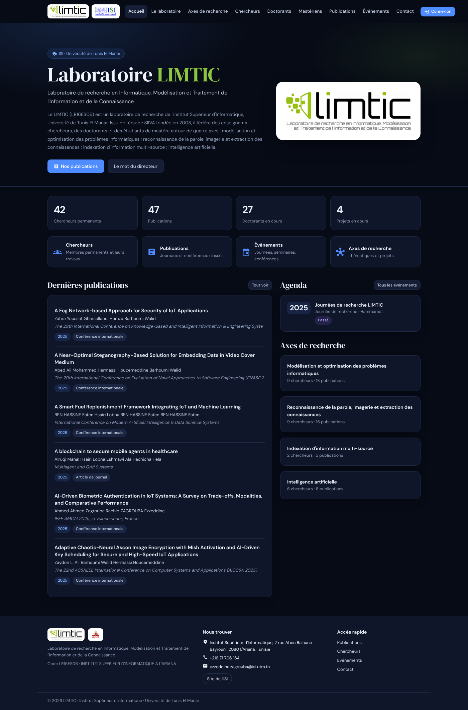
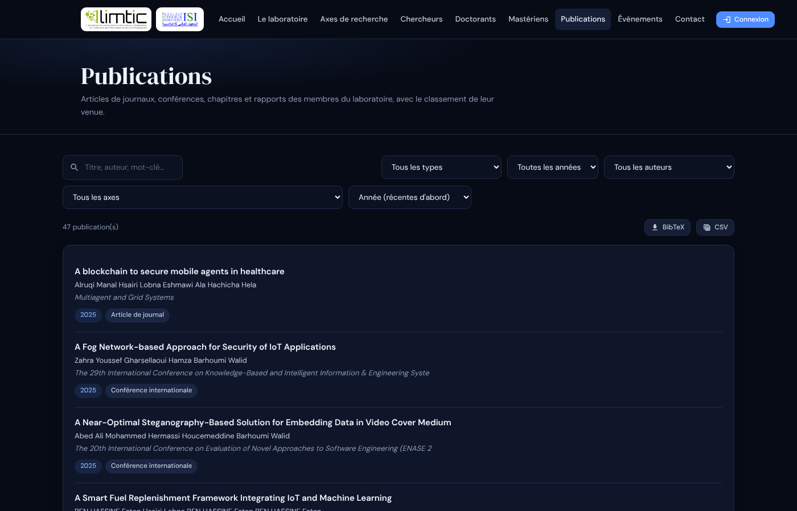
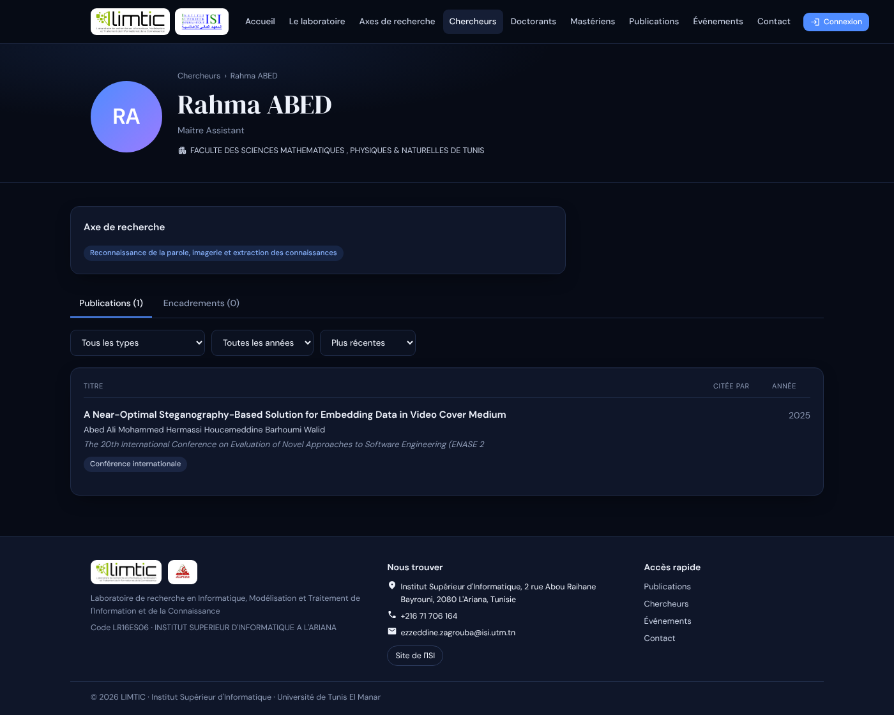
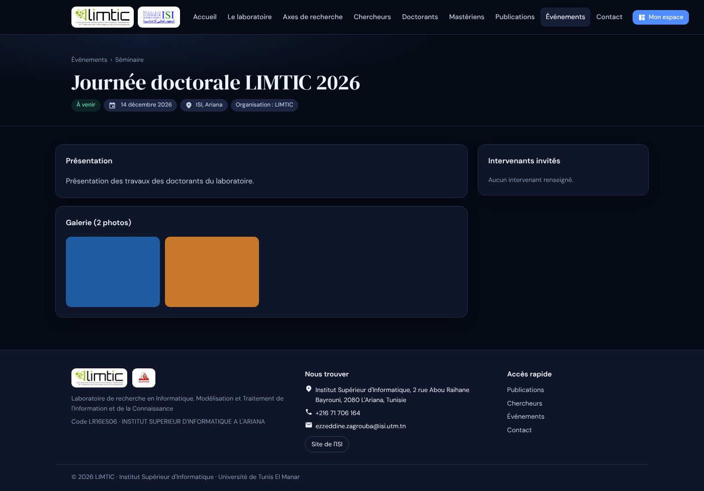
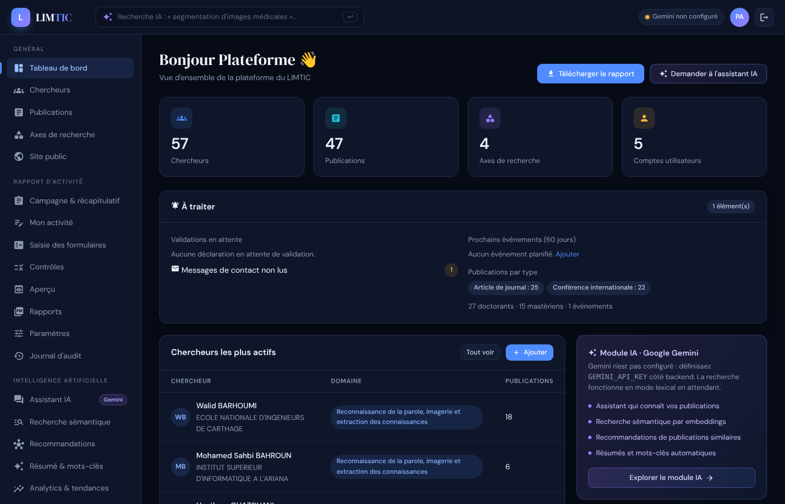
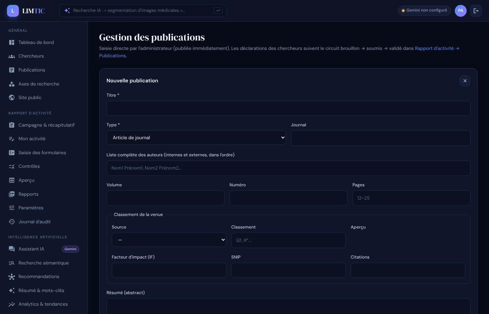
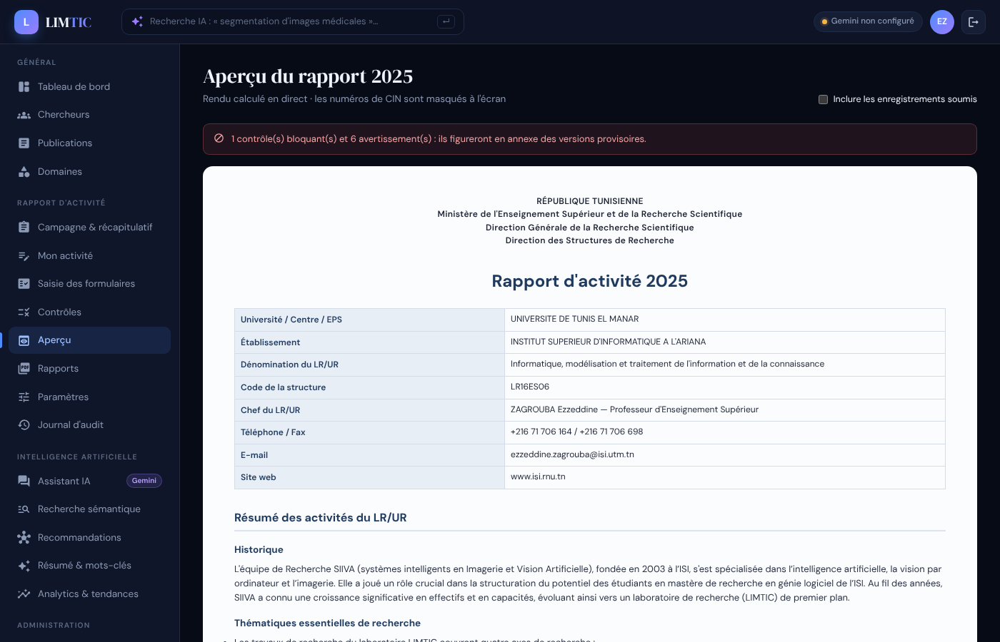
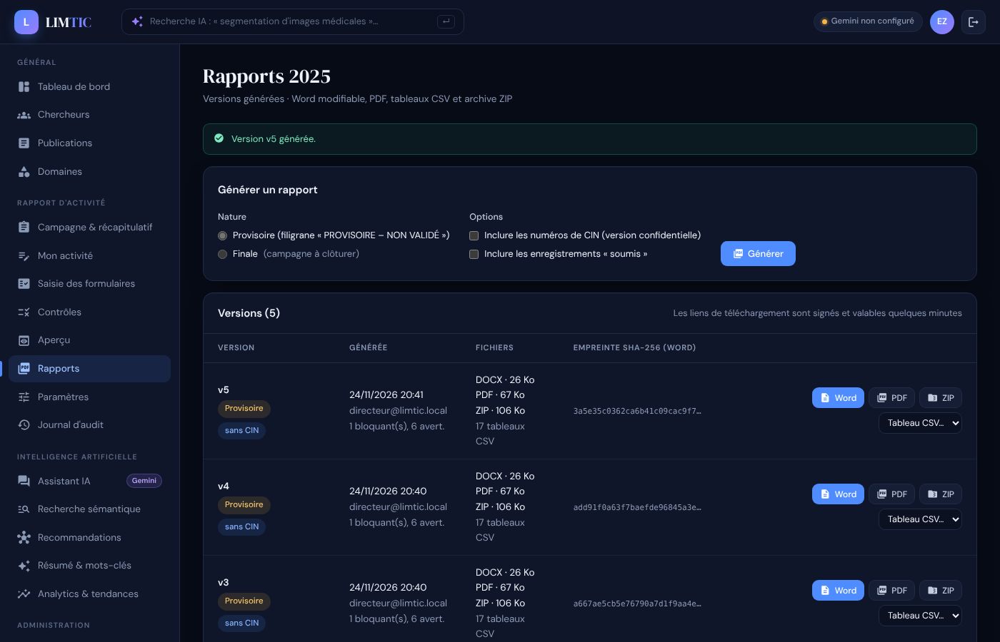
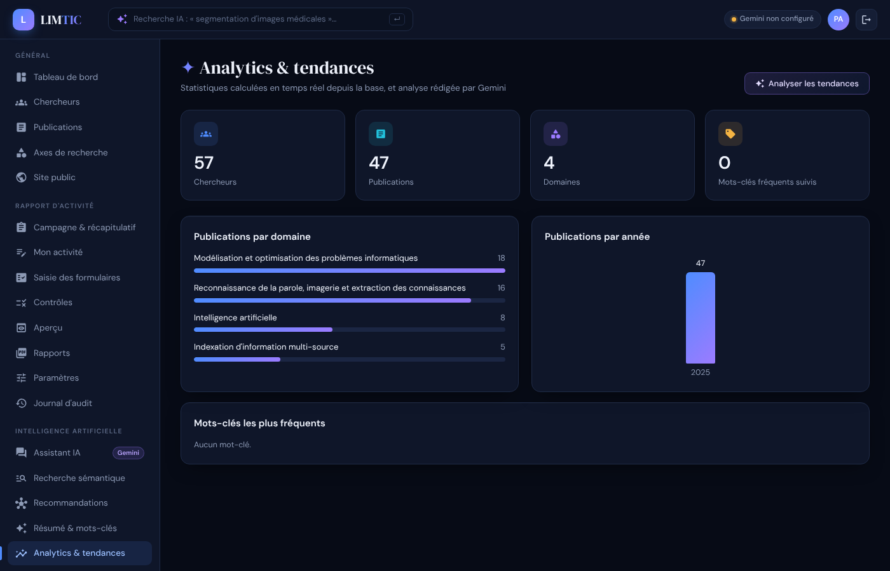
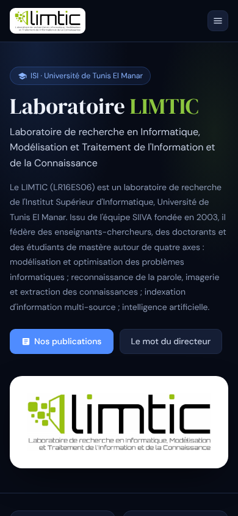

# LIMTIC — Plateforme web du laboratoire

Site web public, back-office et générateur du **rapport d'activité annuel** du laboratoire **LIMTIC**
(Institut Supérieur d'Informatique, Université de Tunis El Manar), avec un **module d'intelligence artificielle** basé sur Google Gemini.

    

## Démonstration

[](docs/demo.mp4)

▶️ **[Vidéo complète en MP4 (80 s)](docs/demo.mp4)** : site public, recherche de publications, profil chercheur, connexion,
tableau de bord, création d'un événement avec galerie photo, classement d'une publication, rapport d'activité 2025 et module IA.

<!-- Pour un lecteur vidéo intégré : sur GitHub, modifiez ce README, glissez docs/demo.mp4 dans l'éditeur
     et remplacez cette ligne par le lien https://github.com/user-attachments/... généré. -->

## Fonctionnalités

**Partie 1 — Site web public et back-office**
- Accueil, page du directeur, axes de recherche, annuaire des chercheurs (photo, ORCID, Google Scholar, ResearchGate, LinkedIn).
- Doctorants et mastériens, publications avec recherche, filtres, badges de classement (Scimago Q1–Q4, CORE A\*–C, facteur d'impact) et export BibTeX / CSV.
- Événements (à venir / archives) avec programme, intervenants et galerie photo ; page contact avec captcha.
- Back-office : chercheurs, publications (avec PDF), axes, événements, paramètres du site, messages, comptes et rôles, alertes.
- Comptes : JWT, rôles (directeur, administrateur, chercheur, modérateur, utilisateur), mot de passe oublié, désactivation.

**Partie 2 — Rapport d'activité annuel**
- Campagne annuelle, formulaires F1 à F18, circuit brouillon → soumis → validé, contrôles bloquants et avertissements.
- Récapitulatif calculé automatiquement, aperçu, génération **Word** et **PDF**, versions et journal d'audit.
- CIN chiffrés en base (AES-256-GCM), jamais exposés publiquement.

**Module IA (Google Gemini)**
- Assistant conversationnel, recherche sémantique (embeddings), recommandations, résumés et mots-clés, analyse des tendances.
- Sans clé Gemini, l'application fonctionne quand même : la recherche passe en mode lexical.

## Captures d'écran

| Accueil | Publications |
|---|---|
|  |  |
| **Profil chercheur** | **Événement et galerie** |
|  |  |
| **Tableau de bord administrateur** | **Saisie d'une publication** |
|  |  |
| **Aperçu du rapport d'activité** | **Génération Word / PDF** |
|  |  |
| **Analytics IA** | **Version mobile** |
|  |  |

## Technologies

| Couche | Outils |
|---|---|
| Backend | Java 17, Spring Boot 3.5 (Web, Security, Data JPA, Validation, Mail), JWT, H2 (ou PostgreSQL), Apache POI (Word), OpenPDF (PDF), jsoup |
| Frontend | Angular 21 (composants autonomes, signals), TypeScript, SCSS, Vitest |
| IA | API Google Gemini (`generateContent`, embeddings) appelée uniquement depuis le backend |

## Structure du projet

| Dossier | Rôle |
|---|---|
| `backend/` | API REST Spring Boot : sécurité JWT, site public, back-office, rapport d'activité, module IA |
| `frontend-test-farah/` | Application web Angular 21 (site public + espace connecté) |
| `docs/` | Vidéo de démonstration et captures d'écran |
| `Frontend/` | Modèle « Mantis » d'origine (template de démonstration, non utilisé par l'application) |

## Prérequis

- **Java 17** ou plus récent (Maven est fourni via `mvnw`)
- **Node.js 20.19+** (ou 22) et npm
- Facultatif : une clé Gemini gratuite sur https://aistudio.google.com/apikey

## Tests

| Partie | Commande | Résultat |
|---|---|---|
| Backend (JUnit 5 + MockMvc) | `cd backend && ./mvnw test` | **24 tests réussis** |
| Frontend (Vitest) | `cd frontend-test-farah && npm test -- --watch=false` | **7 tests réussis** |

Ce que couvrent les tests backend :
- `WebappApplicationTests` (6) : démarrage, consultation publique, absence de CIN dans l'API, accès refusé sans jeton, connexion, recherche sans clé Gemini.
- `SitePublicTests` (5) : pages publiques sans CIN, filtres et export BibTeX/CSV, contact avec captcha, mot de passe oublié (lien à usage unique) et compte désactivé, contrôle du contenu réel des fichiers déposés.
- `RapportActiviteTests` (13) : valeurs du rapport 2025 (annexe E), anomalies détectées, règle III-3 paramétrable, CIN invisibles pour un non-administrateur, versions provisoire et finale, liens de téléchargement signés, réouverture journalisée, workflow du chercheur, fiche individuelle sans CIN, import CSV.

```text
[INFO] Tests run: 13, Failures: 0, Errors: 0, Skipped: 0 -- in com.projetweb.webapp.RapportActiviteTests
[INFO] Tests run: 5, Failures: 0, Errors: 0, Skipped: 0 -- in com.projetweb.webapp.SitePublicTests
[INFO] Tests run: 6, Failures: 0, Errors: 0, Skipped: 0 -- in com.projetweb.webapp.WebappApplicationTests
[INFO] Tests run: 24, Failures: 0, Errors: 0, Skipped: 0
[INFO] BUILD SUCCESS
```

## Installation et lancement

### 1. Lancer le backend

```bash
cd backend
# Clé Gemini gratuite : https://aistudio.google.com/apikey  (ne jamais la mettre dans le code)
export GEMINI_API_KEY="votre_cle"          # Windows PowerShell : $env:GEMINI_API_KEY="votre_cle"
./mvnw spring-boot:run                      # Windows : mvnw.cmd spring-boot:run
```

L'API démarre sur http://localhost:8080. Par défaut la base est **H2** (fichier `backend/data/`), rien à installer.
Au premier démarrage, le jeu d'essai 2025 du LIMTIC (voir plus bas) et 5 comptes sont créés :

| Email | Rôle | Mot de passe |
|---|---|---|
| directeur@limtic.local | Directeur (super-admin), relié à Ezzeddine | `admin123` (ou `ADMIN_PASSWORD`) |
| admin@limtic.local | Administrateur | idem |
| chercheur@limtic.local | Chercheur, relié à  Walid | idem |
| moderateur@limtic.local | Modérateur | idem |
| user@limtic.local | Utilisateur | idem |

#### Variables d'environnement

| Variable | Défaut | Rôle |
|---|---|---|
| `GEMINI_API_KEY` | *(vide)* | Clé Google Gemini. Sans clé : l'assistant/résumés/mots-clés renvoient un message explicite et la recherche passe en mode lexical (TF-IDF). |
| `GEMINI_MODEL` | `gemini-2.5-flash` | Modèle de génération |
| `GEMINI_EMBEDDING_MODEL` | `gemini-embedding-001` | Modèle d'embeddings (recherche sémantique, recommandations) |
| `JWT_SECRET` | secret de dev | **À changer en production** (≥ 32 caractères) |
| `ADMIN_PASSWORD` | `admin123` | Mot de passe des comptes de démo |
| `CIN_ENCRYPTION_KEY` | *(dérivée de `JWT_SECRET`)* | Clé AES-256 (32 octets en Base64, `openssl rand -base64 32`) qui chiffre les CIN en base. **Obligatoire en production, à sauvegarder** : sans elle les CIN sont illisibles. |
| `RAPPORT_LIEN_MINUTES` | `10` | Durée de validité des liens signés de téléchargement du rapport |
| `SEED_DEMO_DATA` | `true` | `false` pour ne pas créer de données de démo |
| `CORS_ORIGINS` | `http://localhost:4200,http://localhost:4000` | Origines autorisées |
| `SPRING_PROFILES_ACTIVE=postgres` + `DB_URL`, `DB_USERNAME`, `DB_PASSWORD` | — | Utiliser PostgreSQL au lieu de H2 |
| `FRONT_URL` | `http://localhost:4200` | Adresse du site, utilisée dans le lien « mot de passe oublié » |
| `SMTP_HOST`, `SMTP_PORT`, `SMTP_USERNAME`, `SMTP_PASSWORD`, `SMTP_AUTH`, `SMTP_STARTTLS` | *(vide)* | Serveur d'envoi des e-mails. Sans SMTP, le lien de réinitialisation est écrit dans les logs du backend. |
| `MAIL_FROM` | `no-reply@limtic.local` | Expéditeur des e-mails |
| `RATE_LIMIT_PER_MINUTE` | `10` | Requêtes POST par minute et par IP sur connexion, inscription, mot de passe oublié et contact |

Tests : `./mvnw test`

### 2. Lancer le frontend

```bash
cd frontend-test-farah
npm install
npm start            # http://localhost:4200
```

L'URL de l'API se règle dans `src/environments/environment.ts`.

## Module IA (Gemini)

Tous les appels Gemini passent par le backend (`/api/ia/*`) : la clé n'est jamais envoyée au navigateur.

| Fonction | Endpoint | Technique |
|---|---|---|
| Assistant conversationnel | `POST /api/ia/chat` | `generateContent` + catalogue des publications en contexte |
| Recherche sémantique | `POST /api/ia/search` | Embeddings Gemini + similarité cosinus (repli TF-IDF sans clé) |
| Recommandations | `GET /api/ia/recommend/{id}` | Embeddings + cosinus |
| Résumé | `POST /api/ia/summarize`, `/summarize/{id}` | `generateContent` |
| Mots-clés | `POST /api/ia/keywords` | `generateContent` avec sortie JSON structurée |
| Analyse des tendances | `POST /api/ia/trends` | Statistiques réelles + `generateContent` |
| État | `GET /api/ia/status` | — |

## Partie 1 — Site web public et back-office (CDC LIMTIC v1.0, chapitres 1 à 10)

### Pages publiques (sans connexion)
| Page | URL | Contenu |
|---|---|---|
| Accueil | `/` | Présentation, chiffres clés, dernières publications, agenda, axes |
| Le laboratoire | `/laboratoire` | Page du directeur (photo, mot du directeur, axes prioritaires) |
| Axes de recherche | `/axes`, `/axes/:id` | Description, responsables, membres, publications et projets de l'axe |
| Chercheurs | `/chercheurs`, `/chercheurs/:id` | Annuaire avec filtres ; profil avec photo, ORCID, Google Scholar, ResearchGate, LinkedIn, publications et encadrements |
| Doctorants / Mastériens | `/doctorants`, `/masteriens` | Sujet et encadrants (aucun CIN) |
| Publications | `/publications`, `/publications/:id` | Recherche plein texte, filtres type / année / auteur / axe / classement, tri, pagination, export **BibTeX** et **CSV** |
| Événements | `/evenements`, `/evenements/:id` | À venir / archives, statut calculé (à venir, en cours, terminé), programme, intervenants, galerie photo avec visionneuse |
| Contact | `/contact` | Coordonnées, carte, formulaire protégé par captcha arithmétique et champ piège anti-robot |

Classements affichés en badges : Scimago **Q1–Q4**, CORE **A\*, A, B, C**, facteur d'impact, SNIP.

### Back-office (administrateur)
- **Gestion publications** : type, venue, liste complète des auteurs, champs propres à chaque type (volume/numéro/pages, lieu/pays, éditeur/ISBN, institution…), classement et source, IF, SNIP, citations, dépôt du PDF.
- **Gestion chercheurs** : photo, bureau, téléphone, liens ORCID / Scholar / ResearchGate / LinkedIn, biographie ; export CSV des chercheurs, doctorants et mastériens (sans CIN).
- **Gestion des axes** : description et responsables.
- **Événements** : programme en texte riche ou PDF, intervenants, galerie photo (glisser-déposer pour l'ordre, légendes).
- **Paramètres du site** : identité, page du directeur, coordonnées, réseaux sociaux, référencement (SEO).
- **Messages de contact** : lecture, marquage lu / non lu, suppression.
- **Comptes & rôles** : activation / désactivation d'un compte (un compte désactivé ne peut plus se connecter).
- **Tableau de bord** : éléments à traiter (validations en attente, messages non lus, prochains événements, publications par type).
- Un chercheur relié à sa fiche modifie lui-même sa page publique (**Ma page chercheur**).
- Mot de passe oublié : lien à usage unique valable 30 minutes (jeton stocké haché).

### Sécurité des fichiers déposés
`POST /api/media` (connecté) accepte seulement JPEG, PNG, GIF, WebP et PDF, vérifiés sur le contenu réel du fichier (et non sur l'extension), 10 Mo par fichier. Les fichiers sont servis avec un en-tête `Content-Security-Policy: sandbox`. Le HTML riche (mot du directeur, programmes) est nettoyé côté serveur (jsoup).

### API publique
`GET /api/public/site | accueil | directeur | axes | axes/{id} | publications | publications/export?format=bibtex|csv | evenements | evenements/{id} | doctorants | masteriens | chercheurs/{id}/encadrements | captcha`, `POST /api/public/contact`, `POST /api/auth/forgot`, `POST /api/auth/reset`.

### Non inclus
- Version anglaise : les textes sont en français dans les composants, pas encore externalisés pour la traduction.
- L'envoi réel des e-mails dépend de la configuration SMTP (variables ci-dessus).
- Les classements (Q1, A*…) sont à saisir pour chaque publication : les données de démonstration importées du rapport 2025 n'en contiennent pas.

## Module « Rapport d'activité annuel » (cahier des charges LIMTIC v3.0, chapitres 11 à 21)

Le module produit le rapport annuel du laboratoire (modèle ministériel) **calculé à partir des données saisies** :
aucun total n'est tapé à la main. Menu « Rapport d'activité » (directeur, administrateur, chercheur).

| Écran | Rôle |
|---|---|
| Campagne & récapitulatif | États Préparation → Saisie ouverte → Revue → Clôturée, récapitulatif calculé avec comparaison N-1, complétude par formulaire et par déclarant, paramètres de calcul |
| Saisie des formulaires | F3 à F17 (membres, doctorants, mastériens, publications, ouvrages, chapitres, brevets, obtentions végétales, habilitations, thèses, mastères, manifestations, conventions, projets). Cycle brouillon → soumis → validé, rejet avec motif obligatoire |
| Identification, Résumé, Situation financière | F1, F2 (3 × 500 caractères, propositions calculées), F18 (reliquat et total calculés) |
| Contrôles | Contrôles bloquants (CIN manquant, champs obligatoires, enregistrements non validés…) et avertissements (bilan textuel ≠ récapitulatif, auteur répété, indexation ≠ table…) avec lien « Corriger » |
| Aperçu | Rendu complet du rapport à l'écran, CIN masqués |
| Rapports | Génération Word (.docx modifiable), PDF, un CSV par tableau et un ZIP. Version provisoire avec filigrane « PROVISOIRE – NON VALIDÉ » et annexe des contrôles ; version finale après clôture, à partir d'une copie figée et chiffrée des données. Versions numérotées, empreinte SHA-256, liens de téléchargement signés (10 min), historique des téléchargements |
| Paramètres | Tables de correspondance (grade → corps, indexation → impactée, type de convention → rubrique), gabarit JSON versionné, import CSV/Excel avec compte rendu ligne par ligne |
| Journal d'audit | Créations, validations, rejets, clôtures, réouvertures, consultations de CIN, générations |
| Mon activité | Espace du chercheur : déclarations et fiche d'activité individuelle (PDF/Word, sans CIN) |

### Protection des CIN

* Chiffrés en base (AES-256-GCM, clé `CIN_ENCRYPTION_KEY`), unicité vérifiée par empreinte HMAC.
* Jamais renvoyés par l'API publique ni affichés sur le site ; consultation unitaire réservée à l'administrateur et journalisée.
* La version du rapport **avec CIN** n'est générée et téléchargeable que par le directeur ; la version sans CIN par l'administrateur.

### Jeu d'essai 2025

`backend/src/main/resources/donnees-essai/2025/` reprend les données réelles du rapport 2025 du LIMTIC
(membres, doctorants, publications, thèses, conventions…) **avec des numéros de CIN fictifs (99xxxxxx)**.
Il contient volontairement deux anomalies pour montrer les contrôles : un membre sans CIN (contrôle bloquant)
et un bilan textuel qui annonce 46 publications alors que le calcul en trouve 47 (avertissement).
Rechargement : Paramètres → « Recharger le jeu d'essai 2025 ».

Valeurs vérifiées par les tests (`RapportActiviteTests`, critères de l'annexe E) : corps A 12, corps B 30,
doctorants 27, cadres 15, étudiants en mastère 15, publications impactées 47, chapitres 3, thèses 7, mastères 14,
manifestations 1, conventions 5.

### API principale

| Méthode | Endpoint | Rôle |
|---|---|---|
| GET/POST/PUT/DELETE | `/api/forms/{categorie}[/{id}]` | Formulaires F3 à F17 |
| POST | `/api/forms/{categorie}/{id}/soumettre` · `/valider` · `/rejeter` | Workflow |
| GET | `/api/forms/{categorie}/{id}/cin` | Consultation d'un CIN (admin, journalisée) |
| GET/POST | `/api/report/campaigns`, PATCH `/api/report/campaigns/{annee}/status` | Campagnes, clôture, réouverture |
| GET | `/api/report/{annee}/summary` · `/checks` · `/preview` | Récapitulatif, contrôles, aperçu |
| POST | `/api/report/{annee}/generate?final=&withCin=&includeSoumis=` | Génération d'une version |
| GET | `/api/report/{annee}/versions`, `/api/report/files/{id}/download?format=` | Versions, lien signé |
| GET | `/api/report/telechargement/{jeton}` | Téléchargement par lien signé |
| POST | `/api/import/{categorie}`, `/api/import/jeu-essai-2025` | Import CSV/Excel |
| GET | `/api/me/activity?year=&format=pdf|docx` | Fiche d'activité individuelle |

### Points ouverts (à confirmer par le laboratoire, §15.6)

* **Rubrique III-3 (coopération)** : par défaut elle compte conventions de coopération + projets (5 en 2025, comme le rapport). Règle modifiable dans les paramètres de la campagne (conventions seules : 0 ; conventions + projets internationaux : 2).
* **Publications « impactées » (II-1)** : la table par défaut ne qualifie que WOS d'impactée, d'où un avertissement sur 12 publications Scopus/autres comptées impactées dans le rapport 2025. Adapter la table si le laboratoire retient une autre règle.
* **Site web** : la valeur du rapport 2025 (`www.isi.rnu.tn`) est reprise, faute d'URL propre au LIMTIC.
* **Relances par e-mail (RA-17)** non implémentées : aucun serveur SMTP n'est configuré. Le suivi se fait par l'écran de complétude.
